## Hey, I'm Nissan

I came at this from the breaking side. Working out how to get into something
is what teaches you where it leaks, and most of what I put up here is that
pointed back the other way: here is what you are giving away without
knowing, and here is what you can actually do about it.

Small tools. One binary each, nothing to install.

### What ties you to yourself

- **[Birthmark](https://github.com/NissanBoss/Birthmark)**: whether the photos you are about to publish carry your camera's mark, which no metadata tool touches
- **[Accent](https://github.com/NissanBoss/Accent)**: what ties your anonymous code to you
- **[Tell](https://github.com/NissanBoss/Tell)**: what the way you write gives away
- **[Earmark](https://github.com/NissanBoss/Earmark)**: which of your accounts a project carries, in the tokens, tags and keys built into it
- **[Byline](https://github.com/NissanBoss/Byline)**: whether the paper you send for anonymous review still names its authors, in the figures, the photos and the supplement
- **[Lineup](https://github.com/NissanBoss/Lineup)**: how many people you could still be, from what an account has said about itself

### What you hand over

- **[Airing](https://github.com/NissanBoss/Airing)**: what your repository releases when it goes public
- **[Alibi](https://github.com/NissanBoss/Alibi)**: what your commit history publishes about you
- **[Baggage](https://github.com/NissanBoss/Baggage)**: what is inside a file before you send it
- **[Pentimento](https://github.com/NissanBoss/Pentimento)**: whether what you cropped, covered or blurred out of a file is really gone
- **[Kerbside](https://github.com/NissanBoss/Kerbside)**: what your dist folder publishes the second you deploy it
- **[Toolmarks](https://github.com/NissanBoss/Toolmarks)**: what the binary you are about to publish says about you
- **[Dunnage](https://github.com/NissanBoss/Dunnage)**: what your container image is still carrying
- **[Workings](https://github.com/NissanBoss/Workings)**: what your notebook publishes
- **[Outtakes](https://github.com/NissanBoss/Outtakes)**: what a terminal recording kept that you did not mean to publish

### What your machine keeps

- **[Verbatim](https://github.com/NissanBoss/Verbatim)**: what your coding agents wrote down
- **[Hearsay](https://github.com/NissanBoss/Hearsay)**: the forty files on your machine that write down what you type
- **[Afterimage](https://github.com/NissanBoss/Afterimage)**: what your machine still remembers about the files you deleted
- **[Glasshouse](https://github.com/NissanBoss/Glasshouse)**: what your computer says about you, and how much of it you can change
- **[Haunts](https://github.com/NissanBoss/Haunts)**: what the networks your computer remembers say about where you have been
- **[Doormat](https://github.com/NissanBoss/Doormat)**: the keys you have left lying about
- **[Ajar](https://github.com/NissanBoss/Ajar)**: which doors your own ssh folder leaves open

### What gets in

- **[Customs](https://github.com/NissanBoss/Customs)**: what an installer can do to you, before you run it
- **[Tally](https://github.com/NissanBoss/Tally)**: what an archive will do when you unpack it
- **[Waxwork](https://github.com/NissanBoss/Waxwork)**: what a model file does when you load it
- **[Tidemark](https://github.com/NissanBoss/Tidemark)**: what something left behind after it ran

### And besides

- **[Fal](https://github.com/NissanBoss/Fal)**: a programming language in Spanish, with [a course](https://aprende.fal-lang.org) that marks its own exercises
- **[Unpick](https://github.com/NissanBoss/Unpick)**: build a cipher out of the usual pieces and watch the oldest attacks take it apart
- **[Octavo](https://github.com/NissanBoss/Octavo)**: turn a PDF into a booklet you can print, fold and staple

### Whatever I build next, these stay the same

**Nothing leaves your machine.** No uploads, no lookups, no telemetry. Not
as a promise either: there is no network code in any of it, and a test reads
the source and fails the build if any turns up.

**Your file stays your file.** Nothing overwrites what you pointed it at.

**It tells you what it could not read.** A short report is not a clean
result. A tool that quietly gives up is worse than no tool, because it hands
you confidence you have not earned.

**No dependencies if I can help it.** Usually that means writing the boring
part myself instead of pulling in somebody else's.

Go most of the time. Rust when it earns its place. Whatever fits the job,
really.

Spain.
